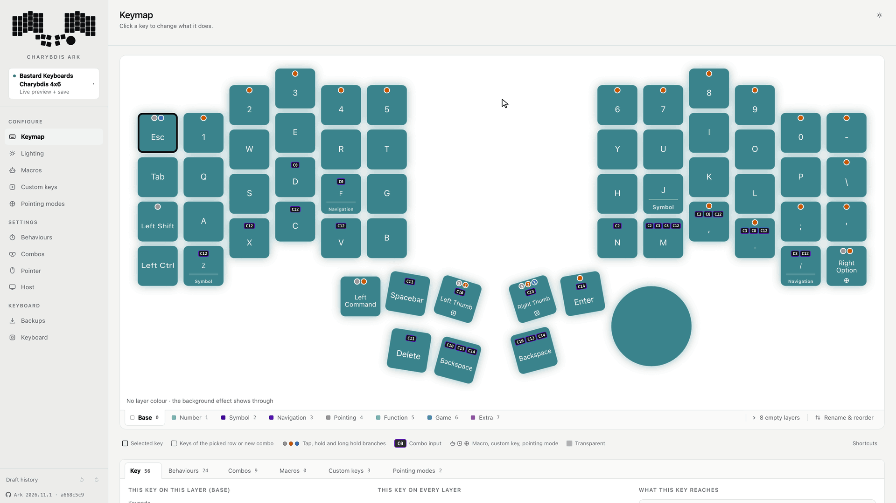
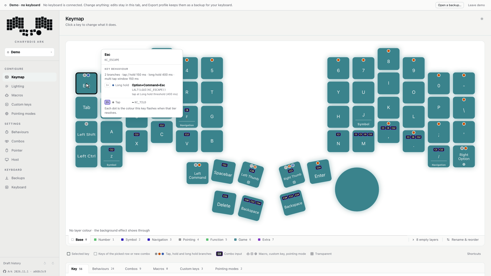
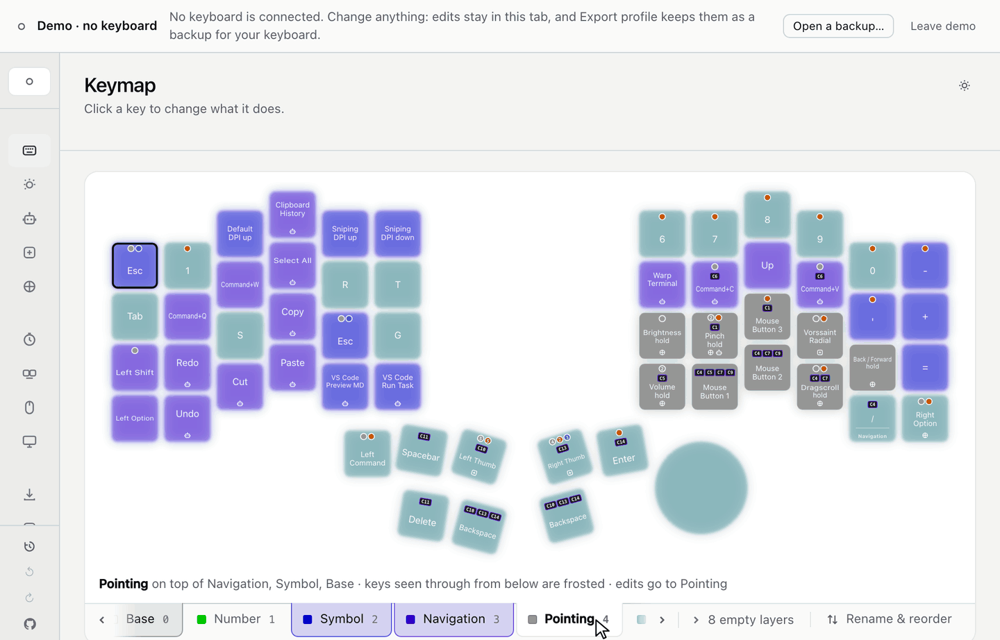
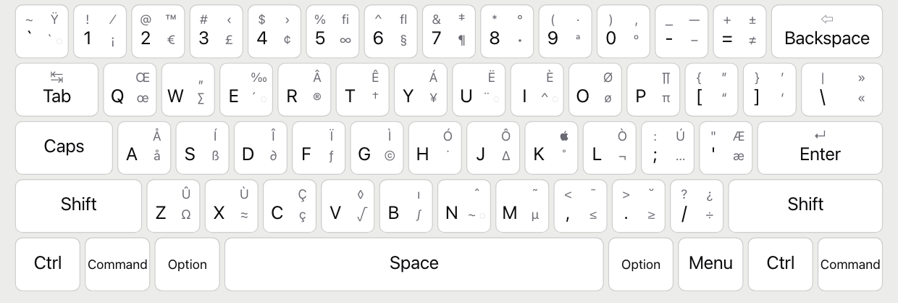
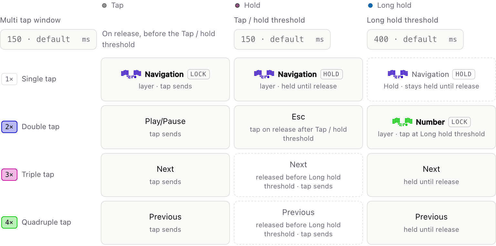
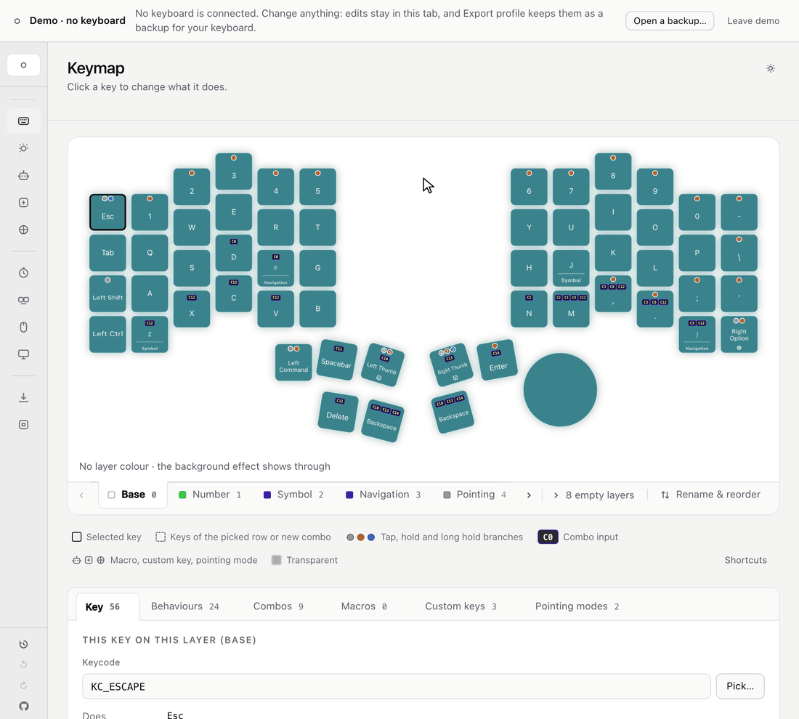
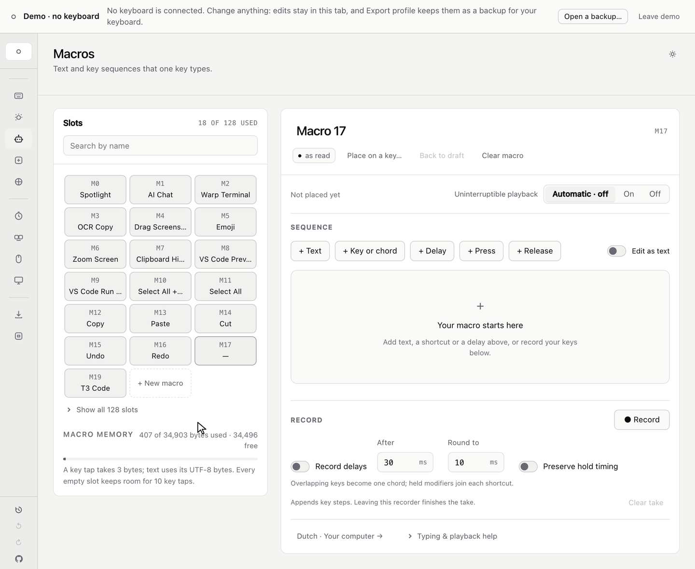
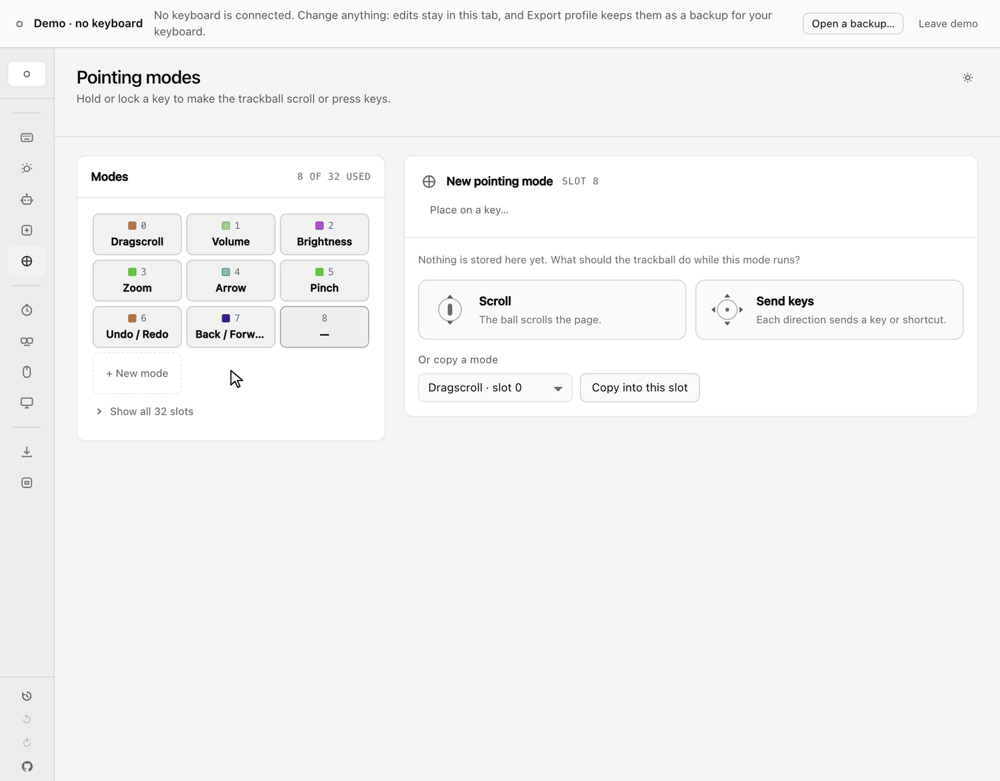
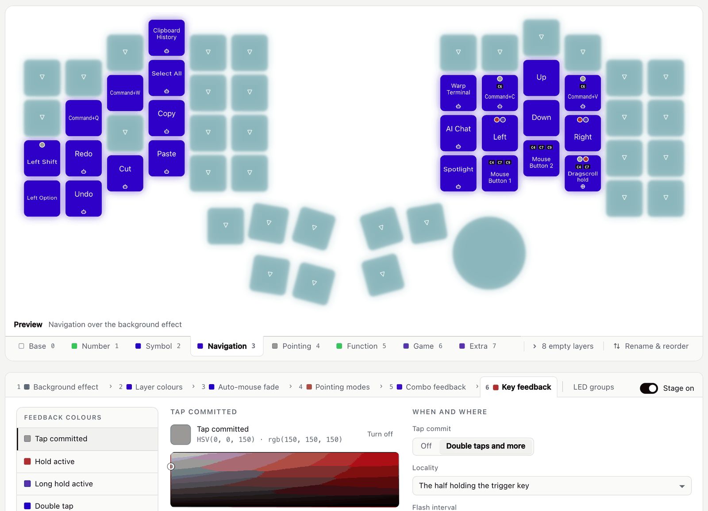
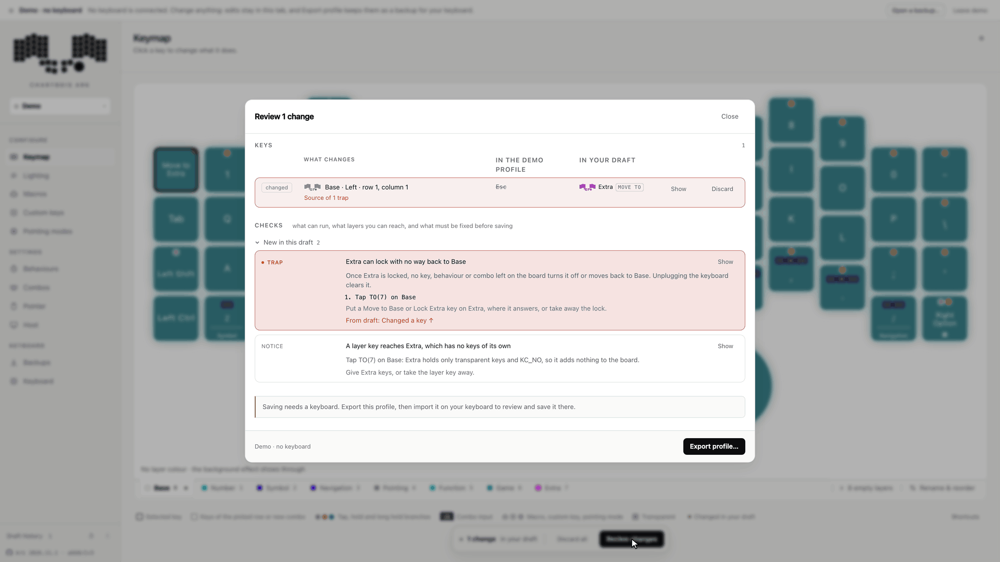

# Charybdis Ark

Ark is the web editor for
[Noah's Charybdis 4x6 firmware](https://github.com/NoahCLR/charybdis-4x6),
and works only with that firmware. Once a keyboard is connected, Ark reads
its profile: keymap, behaviours, combos, macros, autocorrect, trackball and
lighting. In the default edit mode, a change runs on the keyboard from the
next keypress and can be tried in real typing before it is saved.

  <picture>
    <source media="(prefers-color-scheme: dark)" srcset="docs/images/readme/live-edit-dark.gif">
    
  </picture>
   
  Esc changed to Mute, reviewed, then reverted.

**Try the demo:** open <https://ark.ncleroy.dev> and choose
**Explore a demo**. It opens on an example profile close to the firmware's
defaults. Every screen and edit works and Review runs its checks; saving and
the live edit modes need a keyboard. The demo runs in any browser on a
computer, and **Open a backup…** loads your own profile into it.
Connecting a keyboard needs Chrome or Edge. There is no account, and once
the page has loaded it sends nothing to any server. To set up a keyboard,
see [Get started](#get-started).

[The firmware README](https://github.com/NoahCLR/charybdis-4x6#what-the-keyboard-does)
explains layers, behaviours, combos and pointing modes.

The name Ark stands for Adjust, Review, Keep.

## Adjust

### Keymap

The board shows the colours the keyboard lights on the current layer. Dots
mark keys with a behaviour, and a badge like `C12` marks a key that is part
of a combo. Hovering a key lists everything it does. When a combo sends a
key that has a behaviour of its own, a second card shows that behaviour.

  <picture>
    <source media="(prefers-color-scheme: dark)" srcset="docs/images/readme/hover-dark.gif">
    
  </picture>
   
  Hover cards for Esc, <code>V</code> and Right Option.

Drag one key onto another to swap them, or copy a key to another layer with
⌘C and ⌘V (Ctrl on Windows and Linux). Drag a macro, custom key or pointing
mode onto another slot to swap the two: every key that reached it follows,
and so does its colour. When layers are reordered, layer keys
follow their layers by default. ⌘-click (Ctrl-click) several layer tabs to see
them stacked the way the keyboard resolves them:

  <picture>
    <source media="(prefers-color-scheme: dark)" srcset="docs/images/readme/layers-dark.gif">
    
  </picture>
   
  Symbol, Navigation and Pointing stacked in Ark.

### Keycode picker

The picker opens on a keyboard drawn in your computer's layout, with the
Shift and Option (AltGr) characters on each key. Search covers every key the
firmware supports, including macros by name. QMK names such as
`LCTL_T(KC_A)` or `MO(2)` can also be typed into the key's field.

  <picture>
    <source media="(prefers-color-scheme: dark)" srcset="docs/images/readme/keycode-picker-dark.png">
    
  </picture>
   
  The picker on a Dutch Mac layout.

### Behaviours

Each keycode has one grid, with a row per tap count, columns for tap, hold
and long hold, and the timing on top. Empty cells are dashed and show what
the key does there anyway. Behaviours can be switched off for the whole
keyboard, one layer, one behaviour, or one key on one layer, without losing
their settings.

  <picture>
    <source media="(prefers-color-scheme: dark)" srcset="docs/images/readme/behaviour-grid-dark.png">
    
  </picture>
   
  The right thumb key's behaviour.

### Combos and custom keys

To make a combo, pick what it sends, click its keys on the board and keep
it. A combo can fire only on a tap or only when held, need its keys in order,
or run on some layers only.

  <picture>
    <source media="(prefers-color-scheme: dark)" srcset="docs/images/readme/combo-dark.gif">
    
  </picture>
   
  A combo of <code>E</code> and <code>R</code> that sends Command+W.

When a key needs a shortcut that no single keycode can send, such as one
that mixes left and right modifiers (Ctrl+Right Option+K), Ark
offers to make a custom key for it. A custom key has its own name and can
have its own behaviour.

### Macros

Record keystrokes, type or paste text, add keypresses and pauses, and drag the
steps into order. Keys pressed together while recording become one chord.
Shortcuts the computer keeps for itself, such as Command+Space or Command+Tab,
never reach the recorder; add them with **+ Key or chord**, as Command+Space
is added here. A memory bar shows how much room is left. Ark checks each macro
against the computer's layout and Unicode setup, and an edit that adds a
character it can't type says which one and isn't kept.

  <picture>
    <source media="(prefers-color-scheme: dark)" srcset="docs/images/readme/macro-record-dark.gif">
    
  </picture>
   
  Command+Space added as a chord, then <code>notes</code> and Enter recorded, and the macro named Open Notes.

### Autocorrect

List the typos you make and the keyboard fixes them as you finish a word, on
any computer. An entry is one correction with every way you mistype it, so
"because" is written once for `becuase`, `becasue` and `beacuse`. A typo
matches the whole word unless it is set to match the start, the end or any
part of one. Ark checks each entry as it is typed, refuses one the computer's
layout can't type, and marks the ones that would misfire. A starter list of
common English typos is one click away, and a list comes in from, and goes
out to, QMK's text format, a spreadsheet's CSV or JSON. **Try it** shows what
the keyboard would do with a sentence before anything is saved, and a key on
the keyboard switches autocorrect off for a password or a terminal.

### Pointing modes

A pointing mode changes what the ball does while its key is held or locked.
Choose **Scroll** or **Send keys**, click a direction to set what it sends,
and use **Place on a key →** to put the mode's hold key on the board. An
empty mode can be placed on a key and set up later.

  <picture>
    <source media="(prefers-color-scheme: dark)" srcset="docs/images/readme/pointing-mode-dark.gif">
    
  </picture>
   
  A mode that switches desktops on a Mac, once per movement, placed on the Pointing layer.

The **Pointer** screen holds the normal and slow pointer speeds, the layers
that slow the pointer, and the pointer layer that turns on when the ball
moves.

### Lighting

Pick a layer and the board shows what the keyboard will light. Lighting is
built from six stages, from the background effect at the bottom to key
feedback at the top. Key feedback lights tap counts and holds in their own
colours. Any stage above the background can be switched off without losing its
colours, and accents light chosen LEDs in their own colour while a layer,
pointing mode, combo or key feedback shows.

  <picture>
    <source media="(prefers-color-scheme: dark)" srcset="docs/images/readme/lighting-dark.png">
    
  </picture>
   
  Navigation previewed, with the stages and the key feedback colours.

### Host and Keyboard screens

The **Host** screen tells Ark and the keyboard which system the computer runs
(Auto, macOS, Windows or Linux) and which keyboard layout it uses. Keys are
then labelled as the computer types them, and macros type the right
characters. It also has modifier swaps, such as Ctrl with Caps Lock or Ctrl
with Command.

The **Keyboard** screen sets the name the computer shows for the keyboard,
and shows how full the profile is. An edit that wouldn't fit is refused
before it reaches the keyboard.

## Review

While an edit runs on the keyboard unsaved, a bar along the bottom says so.
Edits go into one draft with undo and redo, and the draft history lists each
step and what it changed. In Live edit and Live preview + save, going back to
a step sends it to the keyboard.

Review lists each change next to what the keyboard has saved. **Show** jumps
to where a change is edited, **Discard** drops one change, and **Revert**
drops them all (in Review and save, **Discard all** on the bar does this).

Review traces how each layer can be reached. A trap is a layer or pointing
mode that can lock on with no way out short of unplugging the keyboard. Review
shows the press that leads into it and how to fix it, and **Save to keyboard**
asks before keeping one. Unplugging the keyboard gets you out of a saved trap,
and Ark can then fix it. Review also warns about layers nothing reaches,
combos that can't fire, and macros that a changed layout or Unicode setup can
no longer type. In the live modes, Ark asks before it sends an edit that adds
a trap or a warning.

  <picture>
    <source media="(prefers-color-scheme: dark)" srcset="docs/images/readme/trap-dark.gif">
    
  </picture>
   
  The trap Review finds after Esc is changed to Move to Extra.

To make the same trap in the demo, double-click Esc to open the keycode
picker, choose **Layers**, click **Move to** in Extra's row and
**Use keycode**, then open **Review changes**.

## Keep

There are three edit modes. Pick one under **Edits**, which opens from the
keyboard's name at the top of the sidebar:

- **Live edit:** changes run on the keyboard straight away, and the keyboard
  saves them 3 seconds after the last edit, once no key is held. Unplugging
  before then loses them.
- **Live preview + save** (the default): changes run straight away but are
  kept only on **Save to keyboard**. Unplugging puts back what was saved.
- **Review and save:** the keyboard doesn't change until you save.

The keyboard remembers its edit mode. Closing Ark doesn't change what the
keyboard runs: in Live preview + save, unsaved edits keep running until the
keyboard is unplugged. In Review and save, unsaved edits exist only in the
browser tab, and closing it drops them after the browser asks.

**Save to keyboard** saves the profile on both halves together. Before it
does, Ark stores a recovery copy in the browser, which **Backups** can bring
back. **Export profile…** writes the whole profile to one file, and importing
that file goes through Review like any other change.

## Get started

1. Read
   [Before you flash](https://github.com/NoahCLR/charybdis-4x6#before-you-flash),
   then flash both halves from the
   [latest firmware release](https://github.com/NoahCLR/charybdis-4x6/releases/latest).
2. Open <https://ark.ncleroy.dev> in Chrome or Edge on a computer. The
   page loads the newest Ark each time it opens.
3. Click **Choose keyboard…** and select the keyboard. From then on the page
   connects to it whenever it opens.
4. In **Host**, set your computer's system and keyboard layout, so keys and
   macros type the right characters, and save. Then export a first backup
   from **Backups**.

One browser tab at a time can connect to the keyboard. On Linux, Chrome and
Edge need read and write access to the keyboard's hidraw device, which
usually takes a udev rule. Ark edits only firmware whose profile format it
knows; after a release that changes the format, update both halves first.
Export a backup before every firmware update, since an update can start the
keyboard from the new defaults.

## Learn more

The [Ark guide](docs/guide/README.md) has a page per screen:

- [Connecting](docs/guide/connecting.md) and the demo
- [The board and layers](docs/guide/board-and-layers.md)
- [Keys](docs/guide/keys.md), the picker and custom keys
- [Behaviours](docs/guide/behaviours.md)
- [Combos](docs/guide/combos.md)
- [Macros](docs/guide/macros.md)
- [Autocorrect](docs/guide/autocorrect.md)
- [Pointing](docs/guide/pointing.md)
- [Lighting](docs/guide/lighting.md)
- [Edit modes and Review](docs/guide/review-and-save.md)
- [Backups](docs/guide/backups.md)

Working on Ark itself: [Developing Ark](docs/development.md). Ark is GPL-2.0;
see [LICENSE](LICENSE).
